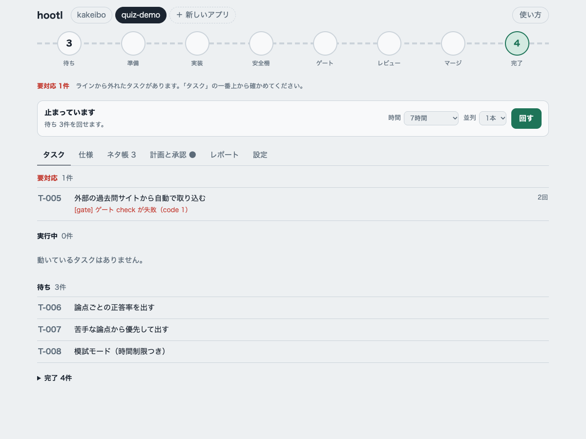
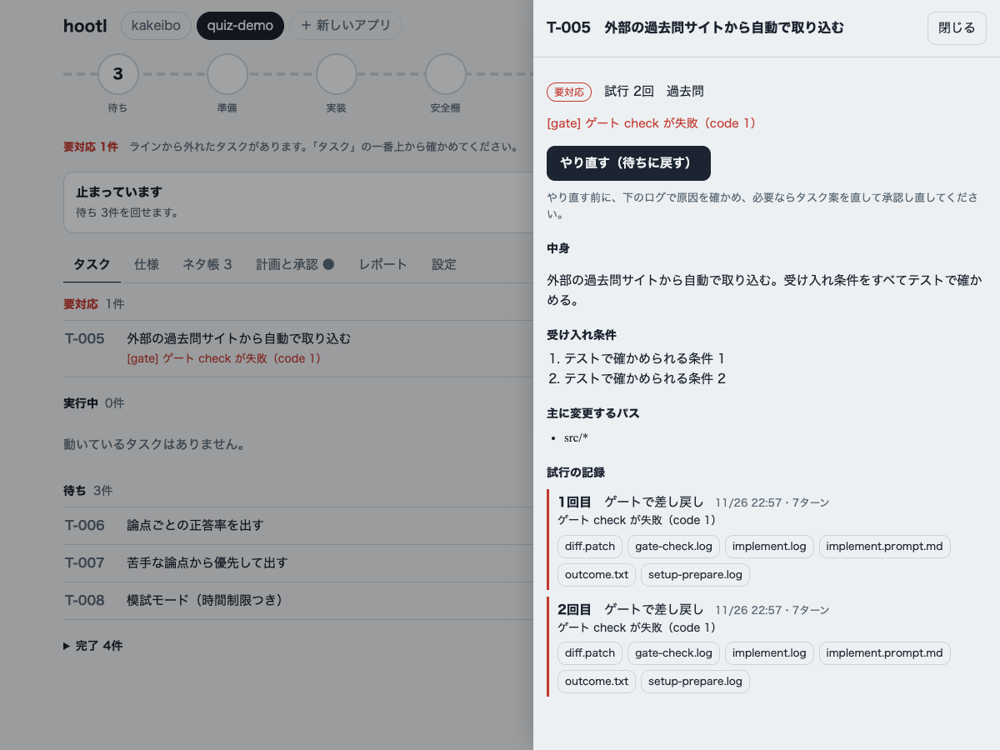
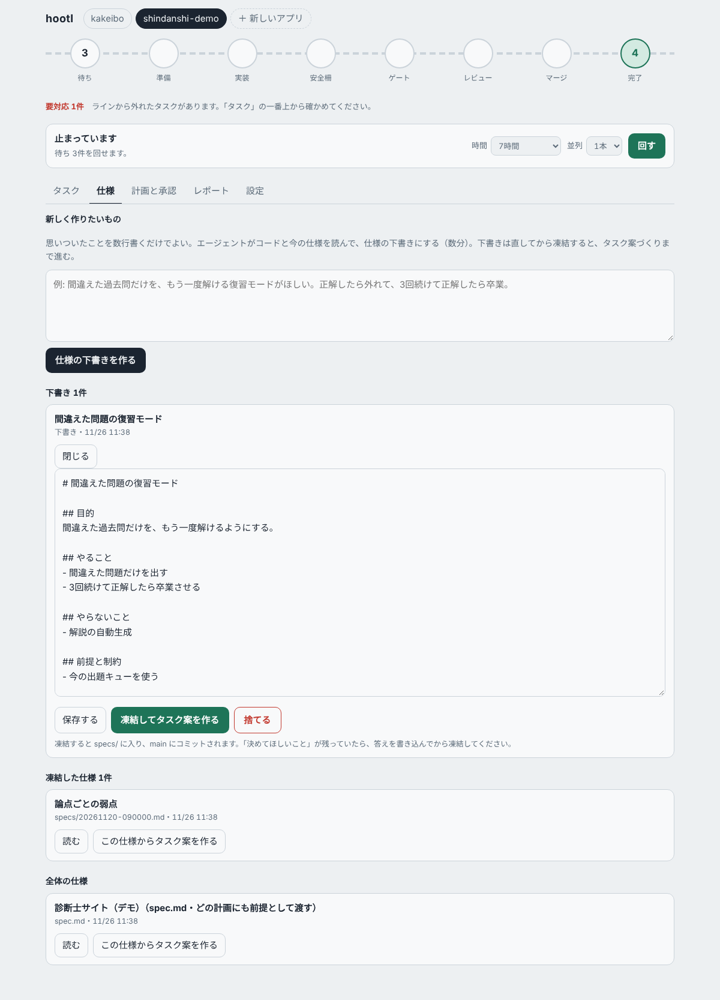
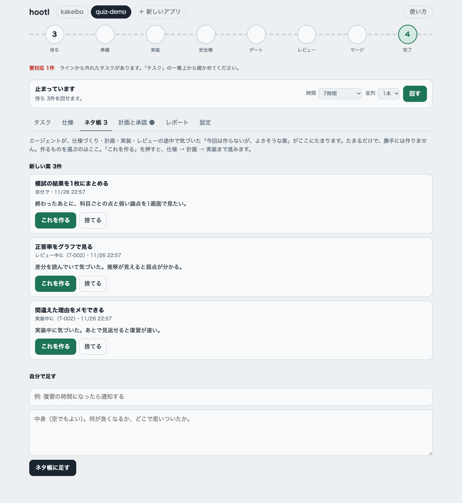
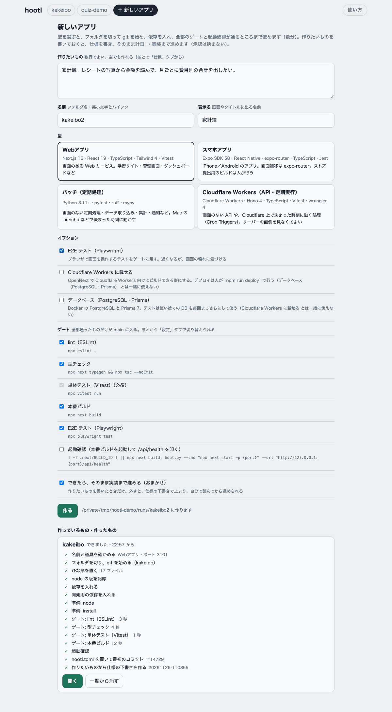
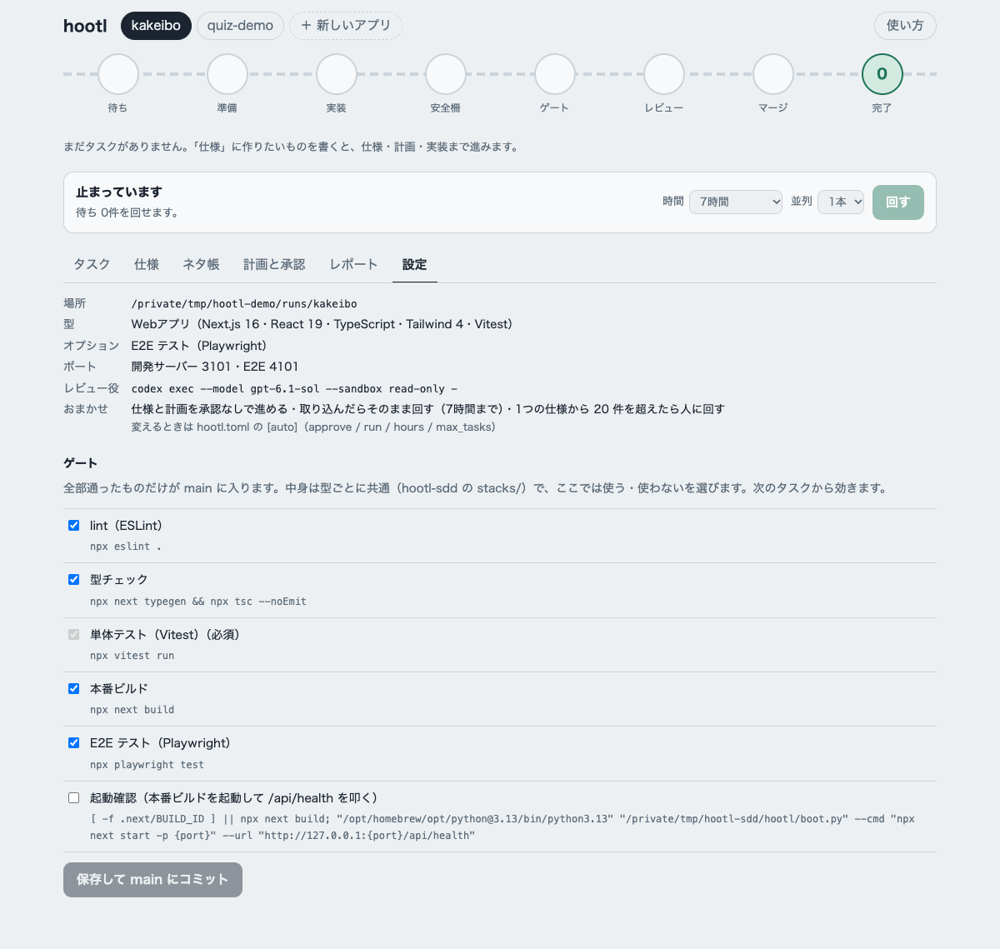

# hootl-sdd

人を介さず（Human-Out-Of-The-Loop）に仕様駆動開発を回しきるためのハーネス。

- 外側はキュー駆動（1タスク＝1セッション）、内側は「実装 → 安全柵 → ゲート → 独立レビュー → マージ」を最大3回
- 「完了」はモデルの申告ではなく、コマンドの終了コードとレビューの verdict JSON で決める
- 詰まったタスクは blocked にして飛ばし、夜全体を止めない
- 人が関わるのは「何を作るかを書く（またはネタ帳から選ぶ）」と「朝の blocked 確認」だけ。仕様の凍結とタスクの取り込みは、人の承認の代わりに機械の確認で進む（おまかせ。`hootl.toml` の `[auto]` で切れる）
- 作業の途中でエージェントが見つけた「今回は作らないが、よさそうな案」は、作らずにネタ帳にたまる

決め打ちした内容は `docs/` にある。

| ドキュメント | 中身 |
| --- | --- |
| [docs/dev-standards.md](docs/dev-standards.md) | タスクの書き方、ブランチ・コミット、完了の定義、テスト規約 |
| [docs/tech-stack.md](docs/tech-stack.md) | ハーネス・エージェント・対象アプリの技術選定 |
| [docs/how-it-works.html](docs/how-it-works.html) | 仕組みの図解（ブラウザで開く） |
| [docs/web-admin.md](docs/web-admin.md) | Web 管理画面の動かし方（手元・スマホから・常時起動） |
| [docs/new-app.md](docs/new-app.md) | 新しいアプリをカタログ（型・オプション・ゲート部品）から作る。カタログの増やし方 |
| [docs/RUNBOOK-onboard.md](docs/RUNBOOK-onboard.md) | 新しいプロジェクトに hootl を導入する手順（Claude Code が実行する）。テンプレートは `kits/_template/` |

## 画面（デモ）

`python3 scripts/demo.py` で、偽のエージェントで動くデモを http://127.0.0.1:8799 に開ける（トークン `demo-token-0123456789abcdef`。claude・codex・npm は要らない）。スクリーンショットは `python3 scripts/screenshots.py` で撮り直せる。

| タスク（ライン） | 要対応のタスク | 仕様 |
| --- | --- | --- |
|  |  |  |
| **ネタ帳** | **新しいアプリ** | **設定（ゲート・おまかせ）** |
|  |  |  |

仕組みの全体像は `docs/how-it-works.html`、管理画面は `docs/web-admin.md`、新しいアプリは `docs/new-app.md`。

## 構成

```
hootl/          ハーネス本体（Python 標準ライブラリのみ）
  cli.py        auto / ideas / plan / import / run / status / report / reset / web
  auto.py       おまかせ（仕様 → 凍結 → 計画 → 取り込み → 実行を、承認なしで1本につなぐ）
  ideas.py      ネタ帳（エージェントの出力の ::idea 行を拾ってためる）
  specs.py      仕様の下書き・凍結、タスク案の確かめ（承認の代わりの機械の確認）
  runner.py     ループ本体
  queue.py      SQLite のキューと状態遷移
  guard.py      安全柵（許可パス・保護ファイル・テスト改ざん）
  gates.py      ゲート（終了コードで判定）
  agents.py     エージェント呼び出し、消費量の取得、verdict の読み取り
  gitops.py     worktree・自動コミット・マージ（直列化）
  report.py     朝のレポート、Discord 通知
  web.py        Web 管理画面（web_static/ に画面）
  setup.py      hootl setup / doctor（Web 管理画面を使い始めるまでを1コマンドで）
  stacks.py     ひな形カタログ（型・オプション・ゲート部品）から hootl.toml を組み立てる
  create.py     hootl new（新しいアプリを作る。git・依存・全ゲート・起動確認・コミットまで）
  boot.py       起動確認（空きポートで起動して応答を見る。全部の型で共通の部品）
prompts/        仕様・計画・実装・レビューのプロンプト（ideas.md はネタ帳の書き方。各役に足される）
templates/      対象リポジトリに置く CLAUDE.md / AGENTS.md / .claude/settings.json
hootl.example.toml
tests/          偽エージェントで全経路を確認するテスト
```

## 使い方

```bash
# 1. ハーネスを入れる
cd hootl-sdd && pip install -e '.[dev]' && pytest   # 6 passed なら OK

# 2. 対象リポジトリの「回す専用の clone」を作る（main に直接マージするため）
git clone <対象リポジトリ> ~/hootl/study-site && cd ~/hootl/study-site
cp ~/path/to/hootl-sdd/hootl.example.toml hootl.toml           # prompts_dir とゲートを直す
cp -r ~/path/to/hootl-sdd/templates/{CLAUDE.md,AGENTS.md,.claude} .
echo ".hootl/" >> .gitignore && git add -A && git commit -m "chore: hootl setup"

# 新しいアプリはカタログから（管理画面の「＋ 新しいアプリ」でも同じ）: docs/new-app.md
# hootl new kakeibo --stack web-next --option e2e --title 家計簿 --idea-file idea.txt

# 3. 作りたいものを書く → あとはおまかせ（管理画面の「仕様」タブの「おまかせで作る」と同じ）
echo "間違えた過去問だけ解き直せる復習モードがほしい" > idea.txt
hootl auto --idea-file idea.txt              # 仕様を書く → 凍結 → 計画 → 確かめて取り込み → 回す
# 全体の spec.md から始めるとき: hootl plan spec.md --approve && hootl run --hours 8

# 3'. 自分で読んでから進めたいとき（承認の道。機械の確認で止まったときもここに来る）
hootl spec-draft --idea-file idea.txt --out draft.md   # 直して specs/ に置く
hootl plan specs/xxx.md                      # .hootl/proposed-tasks.jsonl ができる
$EDITOR .hootl/proposed-tasks.jsonl          # 読んで直す
hootl import .hootl/proposed-tasks.jsonl
hootl run --hours 8 --concurrency 2

# 4. 朝
hootl status                                 # blocked だけ見る
hootl reset T-012                            # 直したら戻す
hootl ideas                                  # 夜の間にネタ帳に増えた案を読む
hootl ideas build 3                          # 選んだ案を、おまかせで作る（捨てるなら drop 3）
```

## 最初にやること

1. `claude --help` と `codex exec --help` で `hootl.example.toml` のフラグが今の版で通るか確認する
2. タスクを2〜3件だけ import して `--concurrency 1` で回し、`.hootl/runs/<ID>/` のログを読む
3. 止まった箇所（権限確認・ゲートの環境差）を潰してから並列を上げる

## 自分の環境に合わせる

- 専用 clone を置く所: `hootl setup --runs-dir <場所>`（既定は `~/hootl-runs`。2回目以降は、決めた場所を覚えている）
- 無人エージェントの権限: 同梱の `stacks/_common/claude-settings.hootl.json` は、どの環境でも要る最小限（push・sudo・`~/.ssh` などの拒否）。自分の環境で守りたい場所は、これを `~/.config/hootl/claude-settings.json` に写して `deny` に足す（あれば、そちらが元になる）。どちらを元にしても、hootl-sdd 自身の編集と `~/.config/hootl/`（管理画面のトークン・権限設定）の読み書きへの拒否は、hootl が毎回足す
- プロジェクトごとの設定（`kits/<名前>/`）は、そのプロジェクトのものなのでコミットしなくてよい。ひな形は `kits/_template/`

### 守りの限界

権限設定の拒否が効くのは、Claude Code のファイルの読み書きの道具に対してだけ。エージェントにはシェルの実行を広く許しているので、コマンド経由（`cat`・`sed` など）までは止められない。安全柵（保護ファイルの変更を差分で検出）とレビューは、対象リポジトリの中の変更しか見ていない。エージェントを信用しきれない使い方（知らないリポジトリを回す、秘密の多いマシンで回す）では、コンテナや専用ユーザーの中で `hootl run` を動かし、そこから見えるものを絞ること。

## ライセンス

MIT（[LICENSE](LICENSE)）
